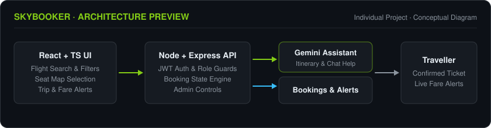
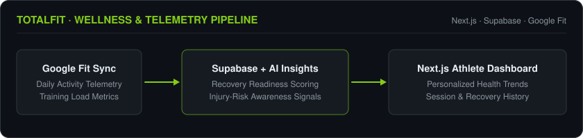

<!--
  Generated automatically from config/*.json via `python scripts/generate_readme.py`.
  Edit JSON files under config/ instead of editing inside the PROFILE markers.
-->

<!-- PROFILE:START -->

[Portfolio](https://aumpanchal.netlify.app/) · [LinkedIn](https://www.linkedin.com/in/aum-panchal-9109a3190/) · [LeetCode](https://leetcode.com/u/aumpanchal/) · [Email](mailto:aumpanchal2004@gmail.com)

[About](#about) · [Experience](#experience-and-timeline) · [Projects](#featured-projects) · [Skills](#engineering-skills) · [Analytics](#github-analytics) · [Connect](#connect)

## About

Computer Science and Engineering graduate from VIT-AP (Class of 2026) focused on building dependable, secure, and maintainable software. I work across backend APIs, relational data modeling, and modern frontend interfaces, applying cloud security and IAM practices to make systems resilient by design.

| Overview | Details |
| :--- | :--- |
| **Current Role** | Software Engineer at LTM (Navi Mumbai · Hybrid) |
| **Engineering Focus** | Full-Stack Web Systems · REST APIs · Cloud & Application Security |
| **Primary Stack** | Java · Spring Boot · Angular · TypeScript · MySQL |
| **Security & Cloud** | VAPT · GRC · IAM · OWASP Top 10 · AWS & Google Cloud |

**Current Engineering Focus**

- Building full-stack applications with Java, Spring Boot, Angular, and TypeScript
- Designing REST APIs, JWT authentication flows, and relational data models in MySQL
- Exploring cloud security posture management (CSPM), IAM hardening, and VAPT automation

## Experience and Timeline

<b>Software Engineer</b> · LTM — Oct 2026 – Present (Full-time · Navi Mumbai, Maharashtra, India · Hybrid)

- Full-time Software Engineer building full-stack enterprise applications at LTM.

**Technologies:** Java · Spring Boot · Angular · TypeScript · MySQL · REST APIs

<b>Graduate Engineering Trainee</b> · LTM — Jul 2026 – Oct 2026 (Apprenticeship · Bhubaneswar, Odisha, India · On-site)

- Gained hands-on exposure to Core Java, Advanced Java, JDBC, SQL, MySQL, Spring Boot, Spring MVC, Spring Data JPA, Hibernate, Spring Security, RESTful APIs, and Angular.
- Explored frontend development concepts including TypeScript, components, services, routing, data binding, dependency injection, and API integration alongside backend MVC architecture, CRUD operations, database connectivity, JWT-based authentication, and authorization.
- Led the SafarMate AI Gladiator group project as Team Lead and independently developed Skybooker.

**Technologies:** Core Java · Spring Boot · Spring MVC · Spring Data JPA · Hibernate · Spring Security · Angular · TypeScript · MySQL · JWT

<b>Market Analyst Intern</b> · Axxela — Jan 2026 – Jul 2026 (Internship · Mumbai, Maharashtra, India · On-site)

- Involved in the execution of trades in commodities and fixed income in International Markets.
- Worked on growing the Asian commodities market covering products such as Palm Oil, Rubber, and Iron Ore, alongside SGX and CME market data analysis.

**Technologies:** Commodities · Fixed Income · International Markets · SGX · CME

<b>Cloud Security Analyst</b> · Suronex — Apr 2025 – Sep 2025 (Internship · Remote)

- Performed vulnerability assessments and penetration testing (VAPT) using Nmap, Nuclei, and custom automation workflows to detect misconfigurations and security loopholes.
- Contributed to Governance, Risk, and Compliance (GRC) by assisting in control mapping, risk assessments, and compliance documentation aligned with industry frameworks (ISO 27001, NIST, CIS).
- Designed and documented standardized workflows for scanning and reporting, improving efficiency and accuracy of security processes.

**Technologies:** VAPT · GRC · Nmap · Nuclei · ISO 27001 · NIST · CIS

<b>B.Tech in Computer Science and Engineering</b> · Vellore Institute of Technology (VIT-AP) — Sep 2022 – May 2026 (Academic · Amaravati, Andhra Pradesh)

- Graduated with CGPA 8.9 / 10 in Computer Science and Engineering.
- Completed core coursework in Data Structures, Algorithms, Operating Systems, Databases, Computer Networks, and Cybersecurity.

**Technologies:** Java · Python · SQL · Computer Networks · Cybersecurity

## Featured Projects

Select any project below to view its architecture, individual contributions, and implementation details.

<b>Skybooker</b> · Individual Full-Stack Project (Completed)

> AI-assisted flight search, seat selection, and itinerary management platform built independently during LTM training.

- **Problem:** Manual flight comparison and multi-leg trip tracking often fragment seat selection, fare alerts, and itinerary updates across disconnected tools.
- **Individual Contribution:** Independently designed and built end-to-end across frontend UI, REST APIs, JWT authentication, booking workflows, and admin management.
- **Architecture:** React + TypeScript SPA communicating with an Express/Node.js REST API, JWT role-based guards, and Gemini API itinerary assistant.

**Key Features**

- Flight search with filtering, fare alerts, and interactive seat selection
- End-to-end booking lifecycle and trip itinerary management
- AI-assisted travel chat and itinerary planning via Gemini API
- Role-protected admin dashboard for flight and booking controls

 Architecture & Booking Flow Preview (conceptual diagram)

**Tech Stack:** React · TypeScript · Node.js · Express · Tailwind CSS · Gemini API · JWT

**Source & Health:** Training project — private source repository · **Live:** Not deployed · **CI:** Not configured · **Docs:** Internal training docs

<b>SafarMate AI</b> · Team-Based Full-Stack Project · Team Lead (Completed)

> AI-powered travel agency platform supporting natural-language package discovery, bookings, and JWT-secured user flows.

- **Problem:** Travellers struggle to map open-ended trip preferences to structured tour packages while agencies need reliable booking and feedback tracking.
- **Individual Contribution:** Led the LTM Gladiator team; architected system flows, contributed to Spring Boot REST controllers, JWT security filters, and Angular integration.
- **Architecture:** Angular SPA with HTTP Bearer interceptor talking to Spring Boot 3.1.5 (Java 17) services, Hibernate/JPA repositories, MySQL, and Gemini API.

**Key Features**

- Natural-language package discovery powered by Gemini structured preference extraction
- Stateless JWT authentication filter with role-based route guards
- Package browsing, booking confirmation, and traveller feedback workflows
- Relational MySQL schema managed via Spring Data JPA and Hibernate

 System Architecture & JWT Sequence Preview (conceptual diagram)

**Tech Stack:** Angular · Java 17 · Spring Boot 3.1.5 · Spring Security · JWT · Spring Data JPA · Hibernate · MySQL · Gemini

**Source & Health:** LTM Gladiator training project — source not public · **Live:** Not deployed · **CI:** Not configured · **Docs:** Architecture diagrams included

<b>PhishNet</b> · Cybersecurity & ML Project (Completed)

> Anti-phishing URL analyzer combining lexical heuristics, feature extraction, and scan history inspection.

- **Problem:** Suspicious links frequently disguise deceptive domains and redirect chains that bypass casual visual inspection.
- **Individual Contribution:** Designed and implemented the URL feature extraction pipeline, classification workflow, and React + TypeScript inspection interface.
- **Architecture:** React + Vite + TypeScript frontend paired with URL lexical/structural feature extraction and ML classification scoring.

**Key Features**

- Multi-signal URL lexical and structural feature inspection
- Heuristic + ML classification verdict with risk breakdown
- Persistent scan history for reviewing previously checked links
- Responsive cybersecurity analysis dashboard

 URL Inspection & Classification Pipeline (conceptual diagram)

**Tech Stack:** React · Vite · TypeScript · Tailwind CSS · Machine Learning

**Source & Health:** [Repository](https://github.com/AumPanchal10/PhishNet) · **Live:** Not deployed · **CI:** See GitHub repository · **Docs:** README available

<b>CryptoWeather Nexus</b> · Real-Time Data & Analytics (Completed)

> Real-time intelligence dashboard unifying cryptocurrency market feeds, global weather data, and news sentiment.

- **Problem:** Tracking live crypto tickers, macro weather events, and market news usually requires switching across isolated dashboards.
- **Individual Contribution:** Built the Next.js + TypeScript application, Redux Toolkit state layer, WebSocket price stream handling, and Recharts visualizations.
- **Architecture:** Next.js App Router + Redux Toolkit consuming live WebSocket market streams, weather APIs, and news feeds, containerized with Docker.

**Key Features**

- Live cryptocurrency price streaming over WebSockets
- Global city weather metrics and historical trend charts
- Aggregated financial/crypto news feed integration
- Containerized deployment setup with Docker

 Real-Time Stream & State Architecture (conceptual diagram)

**Tech Stack:** Next.js · TypeScript · Redux Toolkit · WebSockets · Recharts · Docker

**Source & Health:** [Repository](https://github.com/AumPanchal10/CryptoWeather-Nexus) · **Live:** Not deployed · **CI:** See GitHub repository · **Docs:** README available

<b>TotalFit</b> · AI & Wellness Platform (Completed)

> Athlete wellness platform connecting fitness activity telemetry with recovery indicators and injury-risk insights.

- **Problem:** Athletes and coaches lack unified visibility linking daily training load with recovery readiness and injury signals.
- **Individual Contribution:** Architected and built the Next.js + TypeScript frontend and integrated Supabase/Google Fit activity data with AI insight generation.
- **Architecture:** Next.js + TypeScript web client backed by Supabase/PostgreSQL storage, Google Fit telemetry sync, and AI wellness scoring.

**Key Features**

- Activity and fitness telemetry ingestion via Google Fit
- Recovery readiness and workload trend visualizations
- AI-generated wellness and injury-risk awareness insights
- Persistent athlete profile and session history

 Telemetry & Wellness Insight Architecture (conceptual diagram)

**Tech Stack:** Next.js · TypeScript · Supabase · Google Fit · AI Insights

**Source & Health:** [Repository](https://github.com/AumPanchal10/Totalfit) · **Live:** Not deployed · **CI:** See GitHub repository · **Docs:** README available

<b>LeakSense</b> · IoT & Environmental Monitoring (Completed)

> Connected IoT gas-leakage and air-quality (AQI) monitoring system with live sensor telemetry and alerts.

- **Problem:** Delayed detection of hazardous gas leaks and indoor air degradation creates safety risks in residential and industrial spaces.
- **Individual Contribution:** Developed the sensor telemetry pipeline connecting hardware gas/temperature readings to Firebase/ThingSpeak and the Flutter mobile UI.
- **Architecture:** IoT gas & temperature sensors streaming telemetry to ThingSpeak and Firebase Realtime DB, consumed by a Flutter monitoring app.

**Key Features**

- Continuous gas concentration, temperature, and AQI monitoring
- Real-time cloud sync via Firebase and ThingSpeak channels
- Threshold-based hazard alert notifications
- Cross-platform Flutter mobile monitoring interface

 IoT Sensor-to-Mobile Telemetry Flow (conceptual diagram)

**Tech Stack:** IoT · Gas Sensors · AQI · Firebase · ThingSpeak · Flutter

**Source & Health:** [Repository](https://github.com/AumPanchal10/LeakSense) · **Live:** Not deployed · **CI:** See GitHub repository · **Docs:** README available

<b>IndiVerse</b> · Multilingual Real-Time Communication (Completed)

> Multilingual desktop chat application supporting real-time messaging with server-side language translation.

- **Problem:** Language barriers slow down real-time collaboration across multilingual user groups.
- **Individual Contribution:** Built the Python/PyQt5 client interface and real-time socket/translation messaging pipeline.
- **Architecture:** Python PyQt5 desktop client communicating with a real-time messaging server performing per-recipient message translation.

**Key Features**

- Real-time bidirectional chat messaging across clients
- Automatic server-side translation to each user's preferred language
- Desktop GUI built with Python and PyQt5

**Tech Stack:** Python · PyQt5 · Real-time Messaging · Translation

**Source & Health:** [Repository](https://github.com/AumPanchal10/IndiVerse) · **Live:** Not deployed · **CI:** Not configured · **Docs:** README available

## Engineering Skills

### Core Skills
Technologies I use regularly across full-stack engineering, API design, and problem solving.

| Domain | Technologies |
| :--- | :--- |
| **Languages** | Java · Python · TypeScript · JavaScript · SQL |
| **Backend & APIs** | Spring Boot · Spring Security · REST APIs · Node.js · Express |
| **Frontend** | Angular · React · Next.js · HTML5 · CSS3 · Tailwind CSS |
| **Databases** | MySQL · PostgreSQL · MongoDB |

### Professional & Training Experience
Technologies and security practices applied in verified internships and training delivery.

| Domain | Technologies |
| :--- | :--- |
| **Full-Stack Delivery** | Core Java · JDBC · Spring Boot · Spring MVC · Spring Data JPA · Hibernate · Spring Security · JWT · Angular · TypeScript · MySQL |
| **Cloud & App Security** | VAPT · GRC · CSPM · IAM · Nmap · Nuclei · ISO 27001 · NIST · CIS · OWASP Top 10 |
| **Data & Markets** | Commodities & Fixed Income Execution · SGX & CME Market Analysis |

### Working Knowledge
Tools, frameworks, and platforms implemented across academic and personal projects.

| Domain | Technologies |
| :--- | :--- |
| **Web & APIs** | FastAPI · Django · Redux Toolkit · Recharts · WebSockets · Bootstrap |
| **Data & BaaS** | SQLite · Firebase · Supabase · ThingSpeak |
| **Cloud & Containers** | AWS · Google Cloud · Azure · Docker · Git · GitHub · Postman · Jira |
| **Security Tooling** | Burp Suite · Wireshark · Metasploit · Kali Linux · Linux · Bash |

### Currently Exploring
Engineering areas and tooling I am actively deepening.

| Domain | Technologies |
| :--- | :--- |
| **Architecture & DevOps** | Kubernetes · CI/CD Security Hardening · Microservice Observability |
| **Security Engineering** | SIEM Workflows · GRC Automation · Ghidra · Volatility |

## Education, Certifications & Achievements

- **B.Tech in Computer Science and Engineering**, Vellore Institute of Technology (VIT-AP) (Amaravati, Andhra Pradesh) — September 2022 – May 2026 · **CGPA 8.9 / 10**

<b>Certifications & Verified Achievements</b>

**Certifications**
- AWS Certified Cloud Practitioner — Amazon Web Services (June 2025)
- Google Generative AI — Google Cloud (April 2025)
- Oracle Cloud Infrastructure Foundations Associate — Oracle University (March 2025)
- TATA Cybersecurity Analyst — Tata Consultancy Services / Forage
- Penetration Testing — Udemy

**Achievements**
- Solved 200+ data structures and algorithms problems on LeetCode.
- Placed 6th in a national CTF and bug bounty competition among 100+ teams, leading a 3-member team.

## Currently Building & Learning

| Initiative | Status | Focus |
| :--- | :--- | :--- |
| **Full-Stack Engineering @ LTM** | In Progress | Building enterprise Java, Spring Boot, and Angular applications as a full-time Software Engineer. |
| **Cloud Security & IAM Playbooks** | In Progress | Documenting practical VAPT checks, least-privilege IAM patterns, and OWASP hardening baselines. |
| **GitHub Profile 3.0 Automation** | Completed | Configuration-driven profile generator, local SVG analytics, and validated GitHub Actions pipelines. |

## GitHub Analytics

  <picture>
    <source media="(prefers-color-scheme: dark)" srcset="https://raw.githubusercontent.com/AumPanchal10/AumPanchal10/output/github-snake-dark.svg"/>
    <source media="(prefers-color-scheme: light)" srcset="https://raw.githubusercontent.com/AumPanchal10/AumPanchal10/output/github-snake.svg"/>
    
  </picture>

### Recently Updated Public Repositories

<!--RECENT_REPOS:START-->
- [**TutionAds**](https://github.com/AumPanchal10/TutionAds) — Advertisement for Tutions · TypeScript · updated 2026-11-12
- [**CryptoWeather-Nexus**](https://github.com/AumPanchal10/CryptoWeather-Nexus) — 🌐 A modern multi-page dashboard combining real-time weather, cryptocurrency data, and WebSocket-powered alerts — built with Next.js & deployed publicly. · TypeScript · updated 2026-11-04
- [**Cybersecurity-Projects**](https://github.com/AumPanchal10/Cybersecurity-Projects) — A centralized repository for all my cybersecurity projects, covering various aspects of offensive and defensive security, risk management, and threat detection. This repo contains tools, scripts, and research work aimed at enhancing cybersecurity knowledge and practical implementations. · TypeScript · updated 2026-11-04
- [**PhishNet**](https://github.com/AumPanchal10/PhishNet) — Anti Phishing Detection Tool · TypeScript · ★ 1 · updated 2026-11-04
- [**SentinelOps**](https://github.com/AumPanchal10/SentinelOps) — SentinelOPS is a Security Information and Event Management (SIEM) and Security Operations Center (SOC) monitoring platform designed to demonstrate real-world threat detection, log analysis, security monitoring, and incident response workflows within a controlled cybersecurity laboratory environment. · updated 2026-06-26
<!--RECENT_REPOS:END-->

## Connect

- **Email:** [aumpanchal2004@gmail.com](mailto:aumpanchal2004@gmail.com)
- **LinkedIn:** [Aum Panchal](https://www.linkedin.com/in/aum-panchal-9109a3190/)
- **GitHub:** [@AumPanchal10](https://github.com/AumPanchal10)
- **Portfolio:** [aumpanchal.netlify.app](https://aumpanchal.netlify.app/)
- **LeetCode:** [aumpanchal](https://leetcode.com/u/aumpanchal/)

<i>Progress is a sine wave: consistent learning, iteration, and steady improvement.</i>

<!-- PROFILE:END -->
