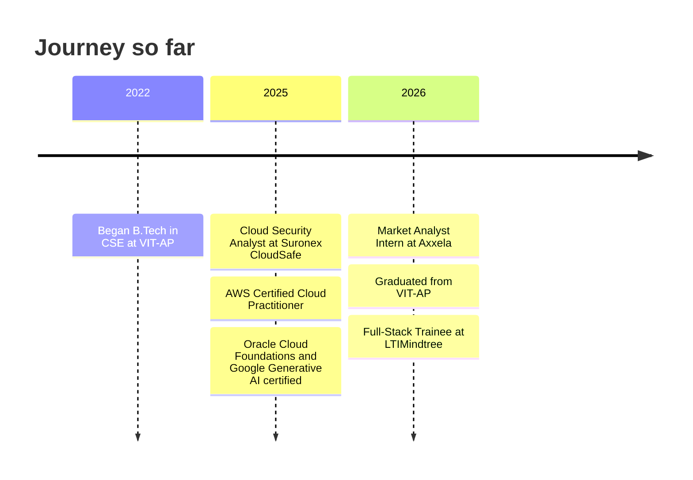
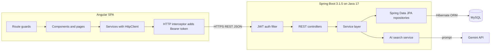
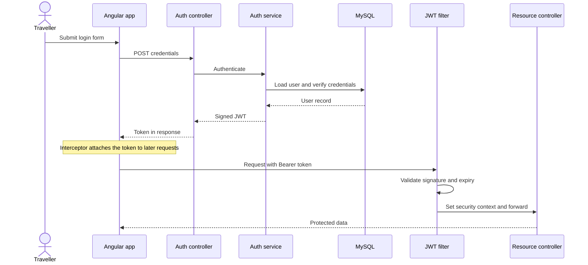
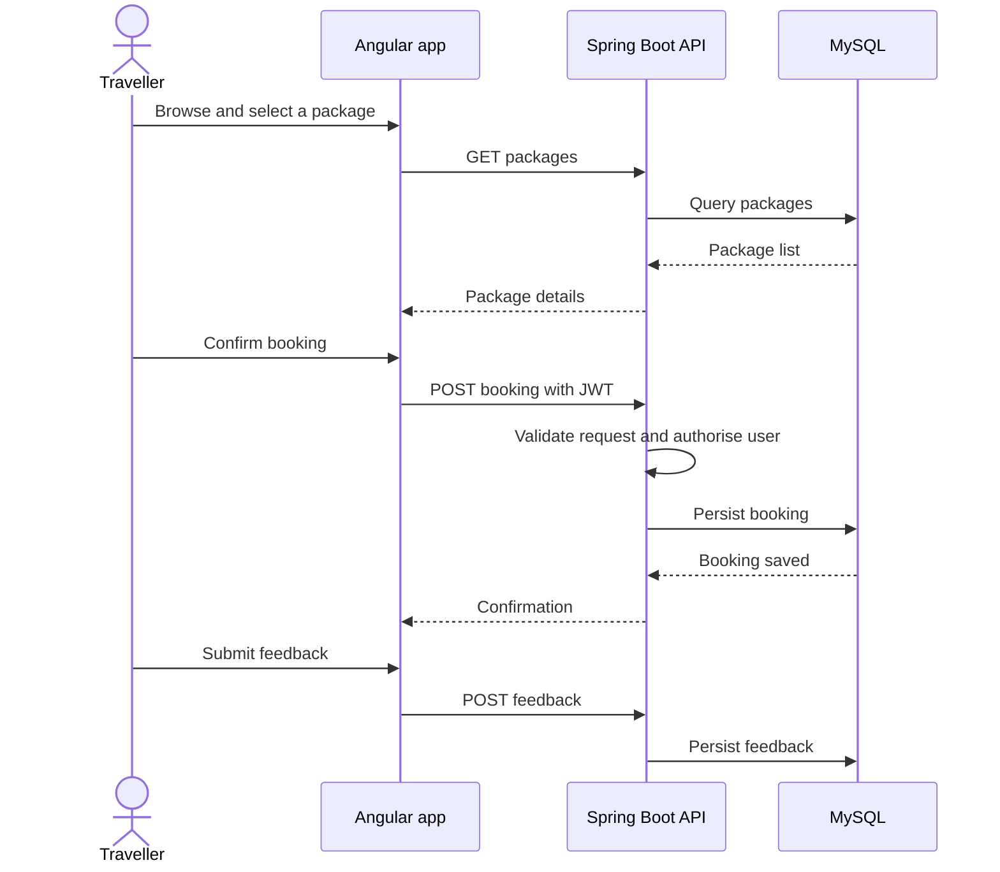
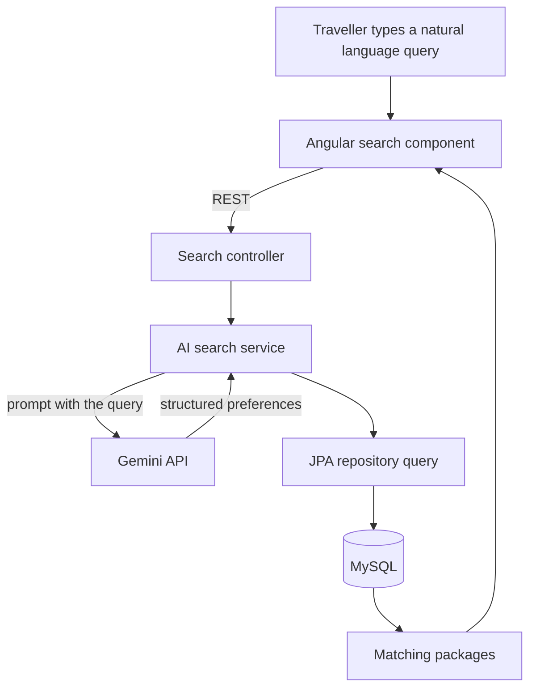
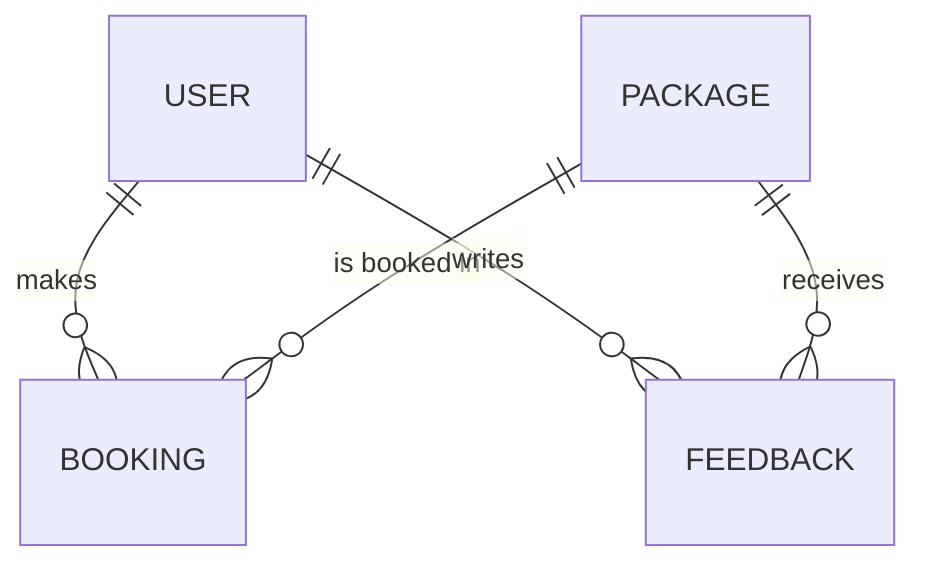
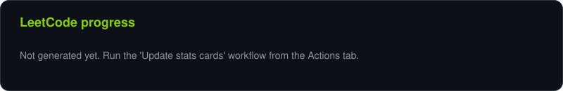

<!--
  The repository list under "Recently updated public repositories" is refreshed weekly by
  .github/workflows/recent-repos.yml (do not remove the RECENT_REPOS marker comments there). The snake (output branch) and assets/stats.svg / assets/leetcode.svg
  are produced by .github/workflows/snake.yml and stats.yml.
-->

  

  

 

## About me

Computer Science and Engineering graduate from VIT-AP (Class of 2026), interested in building useful, secure, and maintainable software. I enjoy working across the stack, from backend services and APIs to frontend experiences, and exploring how cloud and security practices make applications more dependable.

- 🎓 **Education:** B.Tech in Computer Science and Engineering, Vellore Institute of Technology (VIT-AP), September 2022 – May 2026, CGPA **8.9 / 10**
- 💼 **Current role:** Full-Stack Development Trainee at **LTIMindtree**, Media & Entertainment domain, Paramount client account
- 🧭 **Project leadership:** Team Lead for SafarMate AI; independently developed Skybooker during LTIMindtree training
- 🔐 **Interests:** application security, IAM, VAPT, cloud security and full-stack engineering

**Current focus**

- Building full-stack applications with Java, Spring Boot, Angular and TypeScript
- Designing REST APIs, authentication flows and relational data models
- Exploring cloud security, IAM, VAPT and secure application design

<b>🗺️ My journey so far</b> (click to expand)

## Experience

Click a role to expand or collapse it.

<b>Full-Stack Development Trainee</b> · LTIMindtree &nbsp;<i>2026 – Present · Media & Entertainment · Paramount client account</i>

 

- Undertook hands-on full-stack training in Java, Spring Boot, Spring Security, REST APIs, Angular, TypeScript and MySQL.
- Developed backend modules using Spring Data JPA and Hibernate, including JWT-based authentication and RESTful services.
- Integrated Angular frontend components with Spring Boot APIs and MySQL-backed application workflows.
- Led the SafarMate Gladiator group project and independently developed Skybooker through incremental delivery milestones.

      

<b>Market Analyst Intern</b> · Axxela Research and Analytics Pvt. Ltd. &nbsp;<i>January 2026 – Present · Mumbai, India</i>

 

- Analyzed SGX and CME datasets to identify market trends, volatility patterns and spread behaviour.
- Applied analytical modelling to assess exposure constraints and support trading decisions.

   

<b>Cloud Security Analyst</b> · Suronex CloudSafe Pvt. Ltd. &nbsp;<i>April 2025 – September 2025 · Mumbai, India</i>

 

- Executed VAPT using Nmap, Nuclei and custom scripts; identified 20+ critical misconfigurations and exploitable services.
- Reviewed IAM, access controls and encryption; applied CSPM techniques to reduce excessive permissions by 30%.
- Supported compliance readiness against ISO 27001, NIST, PCI-DSS, GDPR, SEBI and RBI requirements.

    

<!-- Tip: add short preview GIFs to assets/previews/ and place  inside a project card below. -->

## Featured projects

Tap a project to see the overview, stack and source.

<b>SafarMate AI</b> &nbsp;·&nbsp; AI-powered travel booking platform &nbsp;<i>Team project · Team Lead · LTIMindtree Gladiator</i>

 

Led the group project and contributed to the full-stack solution spanning package discovery, bookings, feedback and authentication.

        

**Source:** Training project, source not public.

Technical views of the standard Angular, Spring Boot and JWT flows for this stack. Entity and component names are generic.

**1. System architecture**

**2. Authentication with JWT**

**3. Package discovery, booking and feedback**

**4. AI search with Gemini**

**5. Core data model**

<b>Skybooker</b> &nbsp;·&nbsp; AI-assisted flight booking app &nbsp;<i>Individual project · LTIMindtree training</i>

 

Built independently, covering flight search, seat selection, bookings, trip management and fare-alert workflows, with chat and itinerary assistance and admin controls.

      

**Source:** Training project, source not public.

<b>PhishNet</b> &nbsp;·&nbsp; Anti-phishing URL analyzer &nbsp;<i>Cybersecurity · Machine Learning</i>

 

Combines heuristic checks, URL feature extraction, classification concepts and scan history to help inspect suspicious links.

    

**Source:** [AumPanchal10/PhishNet](https://github.com/AumPanchal10/PhishNet)

<b>CryptoWeather Nexus</b> &nbsp;·&nbsp; Real-time intelligence dashboard &nbsp;<i>Real-time data · Analytics</i>

 

Combines cryptocurrency market feeds, global weather information, news sentiment and cross-domain analytics.

     

**Source:** [AumPanchal10/CryptoWeather-Nexus](https://github.com/AumPanchal10/CryptoWeather-Nexus)

<b>TotalFit</b> &nbsp;·&nbsp; Athlete wellness platform concept &nbsp;<i>AI · Wellness</i>

 

Connects fitness activity data with health insights, recovery indicators and injury-risk awareness.

    

**Source:** [AumPanchal10/Totalfit](https://github.com/AumPanchal10/Totalfit)

<b>LeakSense</b> &nbsp;·&nbsp; IoT air-quality monitoring concept &nbsp;<i>IoT · Environmental monitoring</i>

 

Focused on gas and temperature detection, live readings and connected alerts.

     

**Source:** [AumPanchal10/LeakSense](https://github.com/AumPanchal10/LeakSense)

<b>IndiVerse</b> &nbsp;·&nbsp; Multilingual real-time chat &nbsp;<i>Multilingual · Real-time communication</i>

 

Chat application designed for real-time conversations across language preferences, with server-side message translation.

   

**Source:** [AumPanchal10/IndiVerse](https://github.com/AumPanchal10/IndiVerse)

## Technical toolkit

Icons link to each tool's homepage.

**Languages** 

**Frontend** 

**Backend and APIs** 

**Databases** 

**Cloud and DevOps** 

**Cybersecurity** 
                 

## Education

**B.Tech in Computer Science and Engineering**, Vellore Institute of Technology (VIT-AP) 
Amaravati, Andhra Pradesh · September 2022 – May 2026 · CGPA **8.9 / 10**

## Certifications and Achievements

<b>🏅 Certifications</b>

 

- AWS Certified Cloud Practitioner, Amazon Web Services (June 2025)
- Oracle Cloud Infrastructure Foundations Associate, Oracle University (March 2025)
- Google Generative AI, Google Cloud (April 2025)
- TATA Cybersecurity Analyst
- Penetration Testing, Udemy

<b>🏆 Achievements</b>

 

- Solved 200+ data structures and algorithms problems on LeetCode.
- Placed 6th in a national CTF and bug bounty competition among 100+ teams, leading a 3-member team.

## GitHub activity

  <picture>
    <source media="(prefers-color-scheme: dark)" srcset="https://raw.githubusercontent.com/AumPanchal10/AumPanchal10/output/github-snake-dark.svg"/>
    <source media="(prefers-color-scheme: light)" srcset="https://raw.githubusercontent.com/AumPanchal10/AumPanchal10/output/github-snake.svg"/>
    
  </picture>

<b>📊 Stats overview</b> (refreshed weekly)

<b>🧩 LeetCode</b> (200+ problems solved)

**Recently updated public repositories**

<!--RECENT_REPOS:START-->
- [**PhishNet**](https://github.com/AumPanchal10/PhishNet)
- [**CryptoWeather-Nexus**](https://github.com/AumPanchal10/CryptoWeather-Nexus)
- [**Totalfit**](https://github.com/AumPanchal10/Totalfit)
- [**LeakSense**](https://github.com/AumPanchal10/LeakSense)
- [**IndiVerse**](https://github.com/AumPanchal10/IndiVerse)
<!--RECENT_REPOS:END-->

## Connect

- **Email:** [aumpanchal2004@gmail.com](mailto:aumpanchal2004@gmail.com)
- **LinkedIn:** [Aum Panchal](https://www.linkedin.com/in/aum-panchal-9109a3190/)
- **GitHub:** [@AumPanchal10](https://github.com/AumPanchal10)
- **Portfolio:** [aumpanchal.netlify.app](https://aumpanchal.netlify.app/)
- **LeetCode:** [aumpanchal](https://leetcode.com/u/aumpanchal/)

  

<i>⚡ I like to think of progress as a beautiful sine wave: consistent learning, iteration, and improvement.</i>

