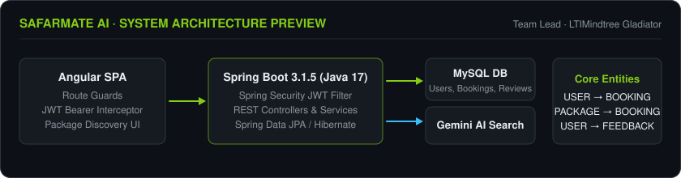
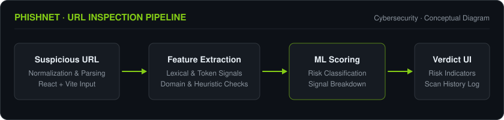
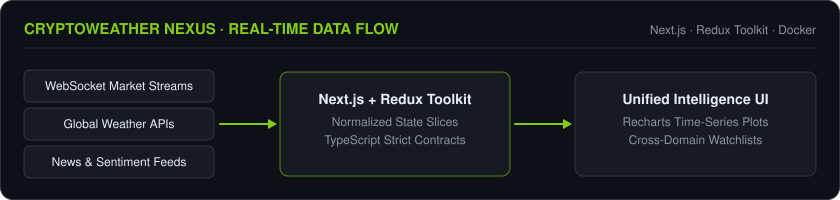
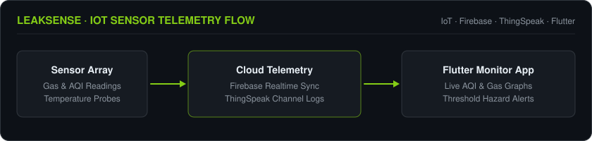
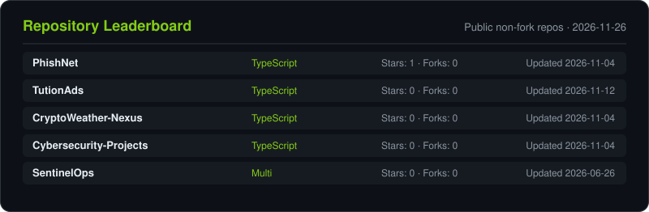

<!--
  Generated automatically from config/*.json via `python scripts/generate_readme.py`.
  Edit JSON files under config/ instead of editing inside the PROFILE markers.
-->

<!-- PROFILE:START -->
<div align="center">


**Software Engineer · Full-Stack · Cloud & Application Security**

[Portfolio](https://aumpanchal.netlify.app/) · [LinkedIn](https://www.linkedin.com/in/aum-panchal-9109a3190/) · [LeetCode](https://leetcode.com/u/aumpanchal/) · [Email](mailto:aumpanchal2004@gmail.com)


[About](#about) · [Timeline](#experience-and-timeline) · [Projects](#featured-projects) · [Skills](#engineering-skills) · [Analytics](#github-analytics) · [Connect](#connect)

</div>

<p align="center"></p>

## About

Computer Science and Engineering graduate from VIT-AP (Class of 2026) focused on building dependable, secure, and maintainable software. I work across backend APIs, relational data modeling, and modern frontend interfaces, applying cloud security and IAM practices to make systems resilient by design.

```bash
$ whoami
Aum Panchal

$ focus
Software Engineering | Full-Stack | Cloud & Application Security

$ currently_building
Spring Boot + Angular full-stack modules & profile automation

$ interests
Backend Systems | IAM & VAPT | Cloud Security | DevOps
```

**Current Engineering Focus**

- Building full-stack applications with Java, Spring Boot, Angular, and TypeScript
- Designing REST APIs, JWT authentication flows, and relational data models in MySQL
- Exploring cloud security posture management (CSPM), IAM hardening, and VAPT automation

<p align="center"></p>

## Experience and Timeline

<details open>
<summary><b>Full-Stack Development Trainee</b> · LTIMindtree <sub><i>2026 – Present · Professional · Media & Entertainment · Paramount client account</i></sub></summary>

- Completed hands-on full-stack training across Java, Spring Boot, Spring Security, REST APIs, Angular, TypeScript, and MySQL.
- Built backend modules with Spring Data JPA, Hibernate, and JWT authentication, integrated with Angular frontend workflows.
- Led the SafarMate AI Gladiator group project as Team Lead and independently built Skybooker through incremental delivery milestones.

      

</details>

<details>
<summary><b>Market Analyst Intern</b> · Axxela Research and Analytics Pvt. Ltd. <sub><i>2026-01 – Present · Internship · Mumbai, India</i></sub></summary>

- Analyzed SGX and CME derivatives datasets to identify market trends, volatility patterns, and spread behavior.
- Applied analytical modeling to evaluate exposure constraints and support trading decisions.

   

</details>

<details>
<summary><b>Cloud Security Analyst</b> · Suronex CloudSafe Pvt. Ltd. <sub><i>2025-04 – 2025-09 · Internship · Mumbai, India</i></sub></summary>

- Executed VAPT assessments using Nmap, Nuclei, and custom scripts, identifying 20+ critical misconfigurations and exploitable services.
- Reviewed IAM policies, access controls, and encryption configurations, applying CSPM practices to reduce excessive permissions by 30%.
- Supported compliance readiness across ISO 27001, NIST, PCI-DSS, GDPR, SEBI, and RBI frameworks.

    

</details>

<details>
<summary><b>B.Tech in Computer Science and Engineering</b> · Vellore Institute of Technology (VIT-AP) <sub><i>2022-09 – 2026-05 · Academic · Amaravati, Andhra Pradesh</i></sub></summary>

- Graduated with CGPA 8.9 / 10 in Computer Science and Engineering.
- Completed core coursework in Data Structures, Algorithms, Operating Systems, Databases, Computer Networks, and Cybersecurity.

    

</details>

<p align="center"></p>

## Featured Projects

<sub>Expand any project to inspect the problem, individual contribution, architecture diagram, features, and health indicators.</sub>

<details open>
<summary><b>Skybooker</b> · Individual Full-Stack Project <sub><i>Status: Completed</i></sub></summary>

> AI-assisted flight search, seat selection, and itinerary management platform built independently during LTIMindtree training.

- **Problem:** Manual flight comparison and multi-leg trip tracking often fragment seat selection, fare alerts, and itinerary updates across disconnected tools.
- **Individual Contribution:** Independently designed and built end-to-end across frontend UI, REST APIs, JWT authentication, booking workflows, and admin management.
- **Architecture:** React + TypeScript SPA communicating with an Express/Node.js REST API, JWT role-based guards, and Gemini API itinerary assistant.

**Key Features**

- Flight search with filtering, fare alerts, and interactive seat selection
- End-to-end booking lifecycle and trip itinerary management
- AI-assisted travel chat and itinerary planning via Gemini API
- Role-protected admin dashboard for flight and booking controls

<p align="center"><br><sub>Architecture & Booking Flow Preview (conceptual diagram)</sub></p>

      

**Source & Health:** Training project — private source repository · **Live:** Not deployed · **CI:** Not configured · **Docs:** Internal training docs

</details>

<details>
<summary><b>SafarMate AI</b> · Team-Based Full-Stack Project · Team Lead <sub><i>Status: Completed</i></sub></summary>

> AI-powered travel agency platform supporting natural-language package discovery, bookings, and JWT-secured user flows.

- **Problem:** Travellers struggle to map open-ended trip preferences to structured tour packages while agencies need reliable booking and feedback tracking.
- **Individual Contribution:** Led the LTIMindtree Gladiator team; architected system flows, contributed to Spring Boot REST controllers, JWT security filters, and Angular integration.
- **Architecture:** Angular SPA with HTTP Bearer interceptor talking to Spring Boot 3.1.5 (Java 17) services, Hibernate/JPA repositories, MySQL, and Gemini API.

**Key Features**

- Natural-language package discovery powered by Gemini structured preference extraction
- Stateless JWT authentication filter with role-based route guards
- Package browsing, booking confirmation, and traveller feedback workflows
- Relational MySQL schema managed via Spring Data JPA and Hibernate

<p align="center"><br><sub>System Architecture & JWT Sequence Preview (conceptual diagram)</sub></p>

        

**Source & Health:** LTIMindtree Gladiator training project — source not public · **Live:** Not deployed · **CI:** Not configured · **Docs:** Architecture diagrams included

</details>

<details>
<summary><b>PhishNet</b> · Cybersecurity & ML Project <sub><i>Status: Completed</i></sub></summary>

> Anti-phishing URL analyzer combining lexical heuristics, feature extraction, and scan history inspection.

- **Problem:** Suspicious links frequently disguise deceptive domains and redirect chains that bypass casual visual inspection.
- **Individual Contribution:** Designed and implemented the URL feature extraction pipeline, classification workflow, and React + TypeScript inspection interface.
- **Architecture:** React + Vite + TypeScript frontend paired with URL lexical/structural feature extraction and ML classification scoring.

**Key Features**

- Multi-signal URL lexical and structural feature inspection
- Heuristic + ML classification verdict with risk breakdown
- Persistent scan history for reviewing previously checked links
- Responsive cybersecurity analysis dashboard

<p align="center"><br><sub>URL Inspection & Classification Pipeline (conceptual diagram)</sub></p>

    

**Source & Health:** [Repository](https://github.com/AumPanchal10/PhishNet) · **Live:** Not deployed · **CI:** See GitHub repository · **Docs:** README available

</details>

<details>
<summary><b>CryptoWeather Nexus</b> · Real-Time Data & Analytics <sub><i>Status: Completed</i></sub></summary>

> Real-time intelligence dashboard unifying cryptocurrency market feeds, global weather data, and news sentiment.

- **Problem:** Tracking live crypto tickers, macro weather events, and market news usually requires switching across isolated dashboards.
- **Individual Contribution:** Built the Next.js + TypeScript application, Redux Toolkit state layer, WebSocket price stream handling, and Recharts visualizations.
- **Architecture:** Next.js App Router + Redux Toolkit consuming live WebSocket market streams, weather APIs, and news feeds, containerized with Docker.

**Key Features**

- Live cryptocurrency price streaming over WebSockets
- Global city weather metrics and historical trend charts
- Aggregated financial/crypto news feed integration
- Containerized deployment setup with Docker

<p align="center"><br><sub>Real-Time Stream & State Architecture (conceptual diagram)</sub></p>

     

**Source & Health:** [Repository](https://github.com/AumPanchal10/CryptoWeather-Nexus) · **Live:** Not deployed · **CI:** See GitHub repository · **Docs:** README available

</details>

<details>
<summary><b>TotalFit</b> · AI & Wellness Platform <sub><i>Status: Completed</i></sub></summary>

> Athlete wellness platform connecting fitness activity telemetry with recovery indicators and injury-risk insights.

- **Problem:** Athletes and coaches lack unified visibility linking daily training load with recovery readiness and injury signals.
- **Individual Contribution:** Architected and built the Next.js + TypeScript frontend and integrated Supabase/Google Fit activity data with AI insight generation.
- **Architecture:** Next.js + TypeScript web client backed by Supabase/PostgreSQL storage, Google Fit telemetry sync, and AI wellness scoring.

**Key Features**

- Activity and fitness telemetry ingestion via Google Fit
- Recovery readiness and workload trend visualizations
- AI-generated wellness and injury-risk awareness insights
- Persistent athlete profile and session history

<p align="center"><br><sub>Telemetry & Wellness Insight Architecture (conceptual diagram)</sub></p>

    

**Source & Health:** [Repository](https://github.com/AumPanchal10/Totalfit) · **Live:** Not deployed · **CI:** See GitHub repository · **Docs:** README available

</details>

<details>
<summary><b>LeakSense</b> · IoT & Environmental Monitoring <sub><i>Status: Completed</i></sub></summary>

> Connected IoT gas-leakage and air-quality (AQI) monitoring system with live sensor telemetry and alerts.

- **Problem:** Delayed detection of hazardous gas leaks and indoor air degradation creates safety risks in residential and industrial spaces.
- **Individual Contribution:** Developed the sensor telemetry pipeline connecting hardware gas/temperature readings to Firebase/ThingSpeak and the Flutter mobile UI.
- **Architecture:** IoT gas & temperature sensors streaming telemetry to ThingSpeak and Firebase Realtime DB, consumed by a Flutter monitoring app.

**Key Features**

- Continuous gas concentration, temperature, and AQI monitoring
- Real-time cloud sync via Firebase and ThingSpeak channels
- Threshold-based hazard alert notifications
- Cross-platform Flutter mobile monitoring interface

<p align="center"><br><sub>IoT Sensor-to-Mobile Telemetry Flow (conceptual diagram)</sub></p>

     

**Source & Health:** [Repository](https://github.com/AumPanchal10/LeakSense) · **Live:** Not deployed · **CI:** See GitHub repository · **Docs:** README available

</details>

<details>
<summary><b>IndiVerse</b> · Multilingual Real-Time Communication <sub><i>Status: Completed</i></sub></summary>

> Multilingual desktop chat application supporting real-time messaging with server-side language translation.

- **Problem:** Language barriers slow down real-time collaboration across multilingual user groups.
- **Individual Contribution:** Built the Python/PyQt5 client interface and real-time socket/translation messaging pipeline.
- **Architecture:** Python PyQt5 desktop client communicating with a real-time messaging server performing per-recipient message translation.

**Key Features**

- Real-time bidirectional chat messaging across clients
- Automatic server-side translation to each user's preferred language
- Desktop GUI built with Python and PyQt5

   

**Source & Health:** [Repository](https://github.com/AumPanchal10/IndiVerse) · **Live:** Not deployed · **CI:** Not configured · **Docs:** README available

</details>

<p align="center"></p>

## Engineering Skills

### Core Skills
<sub>Technologies I use regularly across full-stack engineering, API design, and problem solving.</sub>

- **Languages:** `Java`, `Python`, `TypeScript`, `JavaScript`, `SQL`
- **Backend & APIs:** `Spring Boot`, `Spring Security`, `REST APIs`, `Node.js`, `Express`
- **Frontend:** `Angular`, `React`, `Next.js`, `HTML5`, `CSS3`, `Tailwind CSS`
- **Databases:** `MySQL`, `PostgreSQL`, `MongoDB`

### Professional & Training Experience
<sub>Technologies and security practices applied in verified internships and training delivery.</sub>

- **Full-Stack Delivery:** `Spring Data JPA`, `Hibernate`, `JWT`, `TypeScript`, `Angular`, `MySQL`
- **Cloud & App Security:** `VAPT`, `CSPM`, `IAM`, `Nmap`, `Nuclei`, `OWASP Top 10`
- **Data & Analytics:** `SGX & CME Market Analysis`, `Exposure Modeling`

### Working Knowledge
<sub>Tools, frameworks, and platforms implemented across academic and personal projects.</sub>

- **Web & APIs:** `FastAPI`, `Django`, `Redux Toolkit`, `Recharts`, `WebSockets`, `Bootstrap`
- **Data & BaaS:** `SQLite`, `Firebase`, `Supabase`, `ThingSpeak`
- **Cloud & Containers:** `AWS`, `Google Cloud`, `Azure`, `Docker`, `Git`, `GitHub`, `Postman`, `Jira`
- **Security Tooling:** `Burp Suite`, `Wireshark`, `Metasploit`, `Kali Linux`, `Linux`, `Bash`

### Currently Exploring
<sub>Engineering areas and tooling I am actively deepening.</sub>

- **Architecture & DevOps:** `Kubernetes`, `CI/CD Security Hardening`, `Microservice Observability`
- **Security Engineering:** `SIEM Workflows`, `GRC Automation`, `Ghidra`, `Volatility`

<p align="center"></p>

## Education, Certifications & Achievements

- 🎓 **B.Tech in Computer Science and Engineering**, Vellore Institute of Technology (VIT-AP) (Amaravati, Andhra Pradesh) — September 2022 – May 2026 · **CGPA 8.9 / 10**

<details>
<summary><b>🏅 Certifications & Verified Achievements</b></summary>

**Certifications**
- AWS Certified Cloud Practitioner — Amazon Web Services (June 2025)
- Google Generative AI — Google Cloud (April 2025)
- Oracle Cloud Infrastructure Foundations Associate — Oracle University (March 2025)
- TATA Cybersecurity Analyst — Tata Consultancy Services / Forage
- Penetration Testing — Udemy

**Achievements**
- Solved 200+ data structures and algorithms problems on LeetCode.
- Placed 6th in a national CTF and bug bounty competition among 100+ teams, leading a 3-member team.

</details>

<p align="center"></p>

## Currently Building & Learning

| Initiative | Status | Focus |
| --- | --- | --- |
| **GitHub Profile 3.0 Automation** | `Completed` | Configuration-driven profile generator, local SVG analytics, and validated GitHub Actions pipelines. |
| **Full-Stack Engineering Modules @ LTIMindtree** | `In Progress` | Developing enterprise Spring Boot + Angular workflows during full-stack training. |
| **Cloud Security & IAM Playbooks** | `In Progress` | Documenting practical VAPT checks, least-privilege IAM patterns, and OWASP hardening baselines. |

<p align="center"></p>

## GitHub Analytics

<p align="center">
  <picture>
    <source media="(prefers-color-scheme: dark)" srcset="https://raw.githubusercontent.com/AumPanchal10/AumPanchal10/output/github-snake-dark.svg"/>
    <source media="(prefers-color-scheme: light)" srcset="https://raw.githubusercontent.com/AumPanchal10/AumPanchal10/output/github-snake.svg"/>
    
  </picture>
</p>

<p align="center"></p>

<p align="center"></p>

<p align="center"><a href="https://leetcode.com/u/aumpanchal/"></a></p>

**Recently updated public repositories**

<!--RECENT_REPOS:START-->
- [**TutionAds**](https://github.com/AumPanchal10/TutionAds) — Advertisement for Tutions · `TypeScript` · updated 2026-11-12
- [**CryptoWeather-Nexus**](https://github.com/AumPanchal10/CryptoWeather-Nexus) — 🌐 A modern multi-page dashboard combining real-time weather, cryptocurrency data, and WebSocket-powered alerts — built with Next.js & deployed publicly. · `TypeScript` · updated 2026-11-04
- [**Cybersecurity-Projects**](https://github.com/AumPanchal10/Cybersecurity-Projects) — A centralized repository for all my cybersecurity projects, covering various aspects of offensive and defensive security, risk management, and threat detection. This repo contains tools, scripts, and research work aimed at enhancing cybersecurity knowledge and practical implementations. · `TypeScript` · updated 2026-11-04
- [**PhishNet**](https://github.com/AumPanchal10/PhishNet) — Anti Phishing Detection Tool · `TypeScript` · ⭐ 1 · updated 2026-11-04
- [**SentinelOps**](https://github.com/AumPanchal10/SentinelOps) — SentinelOPS is a Security Information and Event Management (SIEM) and Security Operations Center (SOC) monitoring platform designed to demonstrate real-world threat detection, log analysis, security monitoring, and incident response workflows within a controlled cybersecurity laboratory environment. · updated 2026-06-26
<!--RECENT_REPOS:END-->

<p align="center"></p>

## Connect

- **Email:** [aumpanchal2004@gmail.com](mailto:aumpanchal2004@gmail.com)
- **LinkedIn:** [Aum Panchal](https://www.linkedin.com/in/aum-panchal-9109a3190/)
- **GitHub:** [@AumPanchal10](https://github.com/AumPanchal10)
- **Portfolio:** [aumpanchal.netlify.app](https://aumpanchal.netlify.app/)
- **LeetCode:** [aumpanchal](https://leetcode.com/u/aumpanchal/)

<p align="center"></p>

<p align="center"><i>⚡ I like to think of progress as a sine wave: consistent learning, iteration, and steady improvement.</i></p>
<!-- PROFILE:END -->
